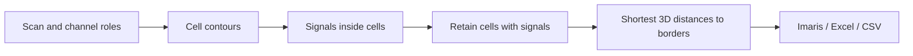
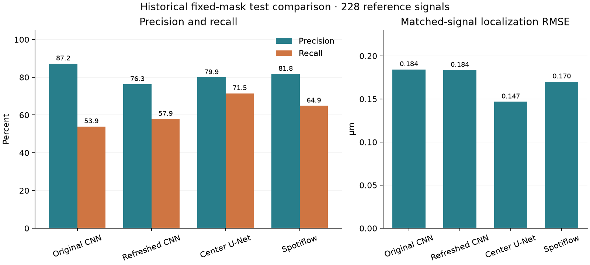

# FISH Analysis

Desktop analysis of Imaris microscopy scans: detect cell contours and fluorescent
signals, measure the shortest 3D signal-to-cell-border distances, review annotations,
and export Imaris, Excel and CSV results. Original scans and annotations are read-only.

**[Download a release](https://github.com/Rokoel/cell-nn/releases/latest)** ·
**[Analysis guide](docs/fish-analysis.md)** · **[Documentation](docs/README.md)** ·
**[Models and evidence](docs/models.md)**


*The running source app displaying an original scan and its saved manual annotations.
This screenshot shows viewing, not an automatic analysis result.*

## Get started

### Standalone application

Download the Windows EXE or Linux AppImage from the release page. Windows includes
a CPU runtime. Linux downloads and verifies its neural runtime on first launch;
allow about 11 GB free during setup and about 8 GB for the retained runtime.
Later launches reuse the installed runtime. See [installation and releases](docs/releasing.md).

### Run from source

Use Python 3.12. Setup installs the GUI/TensorFlow environment and the separate
PyTorch environment used by the default signal detector.

| | Linux | Windows |
|---|---|---|
| First-time setup | `./setup-analysis.sh` | `setup-analysis.bat` |
| Analyze scans | `./run-analysis.sh` | `run-analysis.bat` |
| Explore scans and train models | `./run-viewer.sh FISH` | `run-viewer.bat FISH` |
| Paint training annotations | `./run-annotator.sh` | `run-annotator.bat` |

The existing local environments can be reused. Linux GPU setup for PyTorch is
separate from the default CPU installation; see [signal runtime setup](docs/signal-centers.md).
The desktop needs a working OpenGL driver. See [viewer setup and controls](docs/viewer.md)
for a minimal installation without neural dependencies.

## Analyze a scan

1. Add scans or a folder and select the scans to process.
2. Check the cell and signal channel roles; fluorescence channel order varies by scan.
3. Choose an output folder and review **Pipeline and settings**.
4. Click **Analyze selected**, then inspect **Image**, **Distances** and **Cell counts**.
5. Keep exported `.imx` and `.ims` files together; open the `.imx` in Imaris.

The default uses **both-detector consensus** and the **signal-center 3D U-Net**.
Minimum roundness is 0.72; setting it to zero disables shape rejection.
Other fixed presets and manual editing are described in the [Analysis guide](docs/fish-analysis.md).



Each stage runs in a separate worker process. Results are saved separately from
source data; cancellation preserves completed runs.

## Models and measured limits

All current checkpoints are in [`models/`](models/); their evaluation reports,
plots and tables are in [`reports/`](reports/). Start with the [model inventory](docs/models.md)
and [evaluation guide](docs/evaluation.md).



*Historical signal-detector comparison on 228 reference signals with fixed cell
masks. These scores do not measure the complete current consensus pipeline.
[Source data and protocol](reports/signal-centers/README.md).*

Incomplete manual annotations leave many detected cells unscored. Review real
contours and channel choices before interpreting detection totals as accuracy.
Experimental pipelines retain their own documented evaluation scopes.

## Training data and repository layout

Original scans, annotation crops, checkpoints and bundled reports are preserved.
Historical runs, generated training arrays and build outputs have been removed.
Training caches must be rebuilt before retraining; small reconstruction metadata
is retained locally in `training_metadata/`.

| Folder | Purpose |
|---|---|
| `fish_viewer/` | Analysis, viewer, annotator and worker code |
| `models/` | Bundled inference checkpoints and manifests |
| `reports/` | Release evaluation evidence and plots |
| `docs/` | Usage, model, training and release guides |
| `scripts/`, `tests/`, `packaging/` | Research/build tools, checks and release definitions |
| `FISH/`, `training_annotations/` | Local original scans and annotation data; excluded from Git |
| `training_metadata/` | Local archived splits, recipes, indexes and training provenance |
| `.venv/`, `.venv-spots/`, `.venv-freeze/` | Main, signal and packaging environments; excluded from Git |

See [training data and rebuilding caches](docs/training-data.md). Source installations
use the two working environments for inference as well as training.

## Development

```bash
.venv/bin/python -m pip install -e '.[test]'
.venv/bin/python -m pytest -q
.venv/bin/python scripts/verify_release.py --require-latest-models --with-direct-signals
```

The optional signal suite uses `.venv-spots/`; tests requiring unavailable local
data or optional runtimes skip. [Architecture](docs/architecture.md) explains the
worker boundaries. [Releasing](docs/releasing.md) covers packaging and verification.

## Attribution

The fine-tuned StarDist 2D model derives from the official `2D_versatile_fluo`
checkpoint. Its BSD-3-Clause licence is in
[`PRETRAINED-LICENSE.txt`](models/cells-stardist2d/PRETRAINED-LICENSE.txt).
Please cite Schmidt, Weigert, Broaddus and Myers, *Cell Detection with Star-convex
Polygons*, MICCAI 2018, [DOI](https://doi.org/10.1007/978-3-030-00934-2_30).
