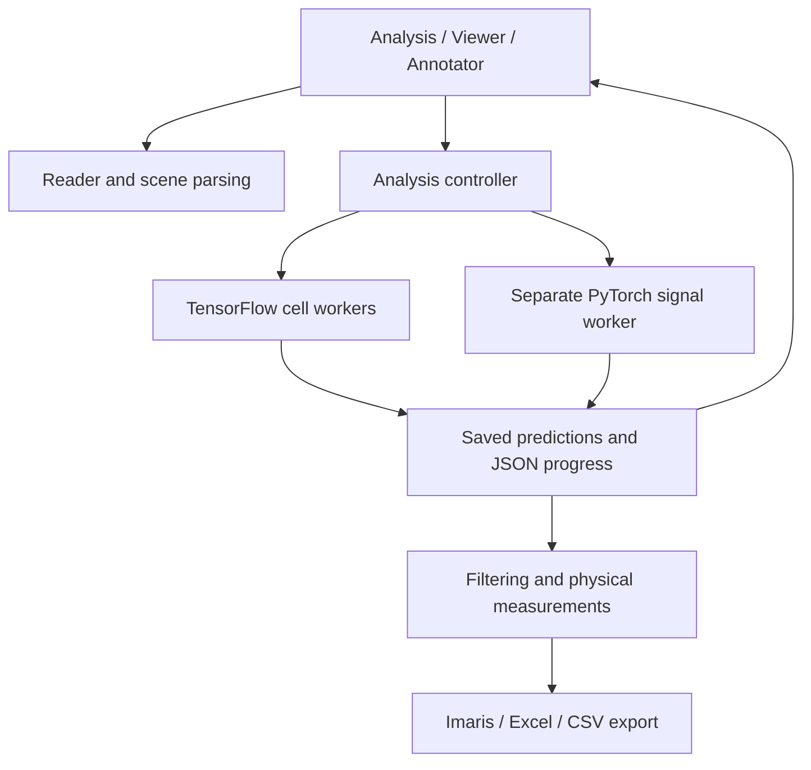

# Architecture

[Documentation](README.md) · [Development entry point](../README.md#development)

The desktop uses PySide6 for controls and PyVista/VTK for 3D rendering. The GUI
loads image/annotation data, starts workers and displays their results. Neural
backends run in child processes so TensorFlow and PyTorch do not share the GUI
process or its GPU state.

| Module | Responsibility |
|---|---|
| `reader.py`, `scenes.py`, `embedded.py` | Imaris pixels, calibration and scene annotations |
| `analysis/` | Sequential processing, result display and editing |
| `annotation/` | Training-only crop sampling and annotation persistence |
| `neural/`, `proposals/`, `refinement/`, `boundary/` | StarDist, cell boxes and boundary models |
| `signals/`, `spots/` | Candidate CNNs and direct PyTorch signal centers |
| `workflow/` | Filtering, calibrated measurements and exports |
| `worker_runtime.py` | Cancellation, CUDA loader setup and shared QProcess environment |
| `project_paths.py` | Bundled model and local audit locations |
| `runtime_cache.py`, `standalone.py` | Packaged runtime installation and worker dispatch |

Workers emit newline-delimited JSON events on stdout and diagnostics on stderr.
A cancellation file or event stops work at operation boundaries. Distinct run
folders preserve previous results. Training uses acquisition groups so duplicate
pixels and related scans do not cross training/validation/test boundaries.

Source launches use `.venv/` for the GUI and TensorFlow, and `.venv-spots/` for
direct signal models. `.venv-freeze/` is retained for packaging. Frozen releases
dispatch workers through the same executable and install their own runtime.

`scripts/package_analysis.py` copies source, documentation and reports once,
validates the checkpoint manifests, records hashes and creates a source archive.
Build binaries and staging directories are generated outputs, not required
training or inference data.
