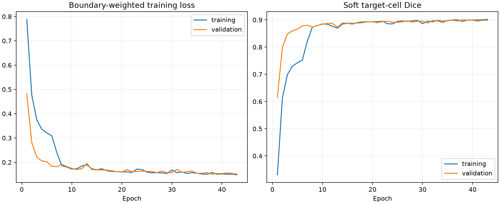

# Seeded 3D U-Net boundary refinement

[Documentation](README.md) · [Models](models.md) · [Analysis](fish-analysis.md)

Generated arrays and historical predictions have been removed. Rebuild training
caches before running reproduction commands; [training data](training-data.md)
explains the retained metadata and dependency order.

This optional stage runs between StarDist cell detection and signal detection.
The existing detector supplies cell identities and seeds. A 3D U-Net reads the
normalized membrane image and a physical Gaussian seed, then predicts target-cell
membership voxel by voxel. There is no star-convex, roundness or elongation constraint.
The signal model is reused without retraining. Distances and volumes use the
same refined meshes shown in the viewer and exported to Imaris.

## In the app

Under **Models and device**, choose a boundary model folder in **Boundaries**.
Leave that field empty to run the original five-stage pipeline. With a boundary
model, the sixth stage shows progress for each cell. Bundled boundary models
are discovered in `models/refinement`, when present.

**Train boundary model…** opens a small training window with preprocessing/batch
progress, the current epoch and live training/validation loss and Dice graphs.
Choose an existing acquisition audit and a new output folder. Training is an
explicit action; analyzing a scan does not retrain the model. Linux supports
the existing TensorFlow CUDA setup; native Windows uses CPU, as before.

## Data and supervision

The original train/validation/test acquisition split, duplicate handling and
four excluded scans/aliases are preserved. Manual surfaces are re-rasterized
from their original calibrated meshes. Complete closed cells are included
without the old shape selection; incomplete edge cells are excluded from
training. Finer sampling defaults to 0.15 µm; coarser native sampling is retained
per axis. Interpolation does not create additional optical resolution.

Each complete manual cell supplies a target-conditioned crop. Every voxel in
that crop has a known membership in *that chosen cell*. A neighboring cell is
not a member of the chosen target; it is not labeled as global background.
Padding is ignored. Synthetic blank/noise targets supplement the positive
crops. These do not replace reviewed real examples of false detections.

Each epoch visits every complete training cell once. Photometric variation,
flips, XY rotations and seed jitter are applied. A Dice plus boundary-weighted
cross-entropy loss emphasizes membrane placement. The best checkpoint and early
stopping use validation loss only. Test cells are never training crops and do
not select checkpoints. The reused historical test split remains exploratory.
After training, `scripts/calibrate_boundary_model.py` can select the mask cutoff
using symmetric boundary error on complete validation crops. This changes only
the specified boundary manifest; keep a copy of the original manifest. Inspect
the resulting real detector-proposal validation comparison before adopting it.

## Conservative application

The refiner creates no new cell identities. It selects the connected predicted
component at the detector seed. Another cell retains ownership of its voxels.
Overlap, volume-change and search-region checks reject implausible refinements.
Membrane evidence is sampled along the actual surface normals, including
indentations, rather than along rays from a centroid.

An invalid refinement retains the original detector contour. This is a fallback,
not a certificate of measurement accuracy. Per-cell acceptance, evidence and
fallback reasons are saved in contour metadata, worker reports and signal
reports. Excel exports add boundary-refinement status and fallback reason to
the Cells sheet when a boundary model was used. Source scans are never changed.

## Commands

The bundled default `models/refinement` is now the crop-robustness fine-tuned
model used with `models/proposals`. The earlier StarDist-refinement checkpoint
is preserved in `models/refinement-base`; its results are in
`reports/boundary-refinement`. See `reports/center-box-contours` for the new
model pair, selection, held-out results and limitations.

```bash
.venv/bin/python -m fish_viewer.refinement --mode train \
  --audit artifacts/evidence-fish/audit/audit.json \
  --cache artifacts/refinement-fish/audit \
  --patches artifacts/refinement-fish/patches \
  --output artifacts/refinement-fish/training --device gpu

.venv/bin/python -m fish_viewer.refinement --mode apply \
  --cells-report path/to/cell-run/report.json \
  --model path/to/boundary-model \
  --output artifacts/refined-cells --device gpu
```

The optional `--audit` argument during application points to the completed
finer-resolution cache to reuse membrane images; it is not needed in the app.
Training writes an atomic best checkpoint, a JSON report, an epoch CSV and
`training-progress.png`. Existing results are never overwritten. Cancel files
and Ctrl-C are checked between preprocessing files, training batches and cells.

## Preserved experiment figure



This figure belongs to the experiment described above and uses its recorded
cohort and settings; it does not summarize all current Analysis presets.
