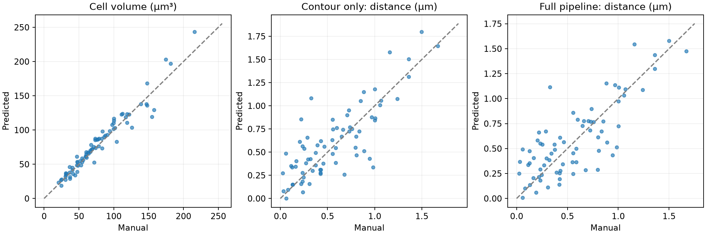

# Held-out volume and distance accuracy

Evaluated on October 7, 2026 using the app's existing balanced StarDist3D cell
checkpoint and 3D signal CNN, with the current acceptance settings. Roundness
and elongation filtering were disabled; visible membrane evidence was required.
No retraining or threshold selection used these test results.

## Cohort and matching

- **71 unique held-out scans, 19 acquisition groups**, from the original fixed
  training/validation/test split. Pixel duplicates are merged and the four
  user-excluded outlier scans and their aliases remain excluded.
- **505 complete manual cell references**; one-to-one whole-object IoU matching
  found **172** with IoU ≥ 0.5 before signal filtering.
- **79 matched complete cells** survived the final rule of at least one accepted
  signal in any non-membrane channel. These are the primary volume cohort.
- The full run found **1,930 cells** before filtering, **364** retained cells and
  **386 signals**. Cells outside manually annotated regions are unknown; these
  totals cannot establish false-positive rates.
- There were **645 manual A markers** across the held-out scans. **144** could
  be assigned an unambiguous channel and unique complete matched manual cell;
  **73** matched predicted signals within **0.6 µm**, in the same cell and channel.
  Conditional matched-signal coverage is 73/144 (50.7%); upstream cell misses and
  ambiguous annotations are outside that denominator.

## Primary results

| Measurement | Pairs | Mean absolute error | RMSE | Bias (predicted − manual) |
|---|---:|---:|---:|---:|
| Cell volume after signal filtering | 79 | 7.711 µm³ | 10.682 µm³ | +2.096 µm³ |
| Distance, same manual A / predicted border | 73 | 0.1805 µm | 0.2400 µm | +0.0442 µm |
| Distance, predicted A / predicted border | 73 | 0.1907 µm | 0.2426 µm | +0.0216 µm |

Volume mean absolute percentage error is **10.15%**;
median absolute percentage error is **9.80%**.
The 95th percentile absolute distance error for the full pipeline is
**0.4543 µm**. Distance percentage errors are unstable near
zero, so physical errors in µm are the primary distance statistics.

Acquisition-group bootstrap 95% intervals for mean absolute error (2,000
resamples, seed 42) are **6.272–9.081 µm³**
for volume and **0.1613–0.2024 µm** for
full-pipeline distance.

Before signal filtering, the 172 matched complete cells have volume MAE
**7.246 µm³**, RMSE **9.612 µm³**, and mean absolute
percentage error **11.32%**. This comparison
helps expose selection by the final signal filter.

## Definitions and exclusions

Volumes compare the enclosed **closed triangle mesh** of a manual cell with the
same calibrated predicted mesh used by the app and Imaris exporter, in µm³.
Triangle orientation is made consistent and zero-area pole triangles are
removed; open/non-manifold reference meshes are excluded. No reference meshes
in the primary 79-cell cohort failed the closure check. Voxel-count volumes are
available in application exports as a separate definition and are not mixed
with manual mesh volumes in this benchmark.

Distances are compared primarily against the **stored human A–B line length**,
using the original B markers. The report also compares against the mathematically
closest point on the manual cell mesh. Manual stored A–B versus exact manual-mesh
shortest distance has MAE **0.00559 µm** over 152 pairs, supporting the
interpretation of B as the first contact of an expanding sphere.

The contour-only comparison fixes the manual A coordinate and changes only the
boundary. It requires that A lie inside the matched predicted cell, with no
boundary gap, and that the cell survive signal filtering. The full-pipeline
comparison uses the CNN's A coordinate and its closest B on the assigned
predicted mesh. Manual markers in overlapping reference cells are excluded to
avoid assigning a distance to the wrong cell. Channel-ambiguous markers are
excluded from signal matching. Partial cells touching scan edges are excluded
from the primary comparisons.

These are **conditional errors on matched detections**, not a claim that the
model detects 90% of cells or signals. Only 79/505 complete manual references
survive the final intersection. The reused test split was inspected during
earlier development, so this is an exploratory benchmark rather than a fresh
independent validation study. Similar contour-only and full-pipeline distance
errors suggest that contour placement contributes substantially to the remaining
error in this matched subset.

## Files and reproducibility

`reports/measurement-accuracy/` contains the numeric Excel workbook, per-scan,
per-cell and per-signal CSVs, scatter plot, and summary JSON including checkpoint
SHA-256 hashes. The workbook keeps all candidate cell matches (IoU ≥ 0.1); apply
`iou >= 0.5`, `complete`, and `retained_after_signal_filter` to reproduce the
primary cell cohort. Distance tables include their corresponding eligibility
flags. No original scan or manual annotation was modified.

The full local inference run is under `artifacts/measurement-benchmark/`.
`scripts/benchmark_measurements.py` accepts the original acquisition audit,
cell-application report, signal model folder and output directory. Run cell
inference with the existing checkpoint and `--evidence-only` on the original
held-out entries. The script uses annotations only for evaluation; signal
candidates and CNN predictions use raw channels and predicted cells only.
The `--wait` option can consume a running cell report; `--refresh-volumes`
reintegrates saved matches without repeating neural inference. The private
original dataset/cache is required to rerun the benchmark; it is not bundled.
