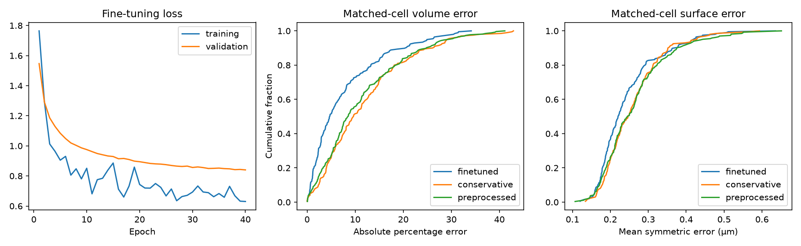

# Fine-tuning official single-channel StarDist2D

[Documentation](README.md) · [Models](models.md) · [Analysis](fish-analysis.md)

This experiment initializes from `2D_versatile_fluo`, downloaded from the [official model release](https://github.com/stardist/stardist-models/releases/tag/v0.1). Its archive SHA256 is checked against the official StarDist registry. It predicts XY polygons; a separate adjacent-section linker produces 3D instances.

The corrected single cell channel is chosen by the existing stain-aware channel selector, including Lam/LBR excitation metadata. Purple/green display colors are not network inputs. Signal channels are excluded. The fixed membrane-connected-v1 preprocessing recipe is used for both the pretrained baseline and fine-tuned network. Intensities and masks are enlarged twofold in XY.

All eligible complete manual cells from the established 215 training scans contribute up to seven sections each. The 73 validation and 71 test scans keep their acquisition-group assignments. Unknown pixels, including unmarked cells, retain label -1 and contribute neither probability loss nor distance regularization. Synthetic empty/noise crops provide background supervision; they do not replace reviewed real negatives.

Run training and evaluate all held-out scans:

```bash
.venv/bin/python scripts/finetune_stardist2d.py \
  --audit artifacts/preprocessed-stardist-stain-aware-20261010/audit/audit.json \
  --output artifacts/stardist2d-finetune-20261010

.venv/bin/python scripts/report_stardist2d.py \
  --run artifacts/stardist2d-finetune-20261010
```

A new training run needs a fresh output directory. Evaluation can be repeated with `--evaluate-only`; it reuses the best validation-loss checkpoint and the fixed original probability threshold, without fitting on the test set. GPU support uses the existing Linux TensorFlow environment; `--device cpu` is available for Linux and Windows. On Windows use the corresponding environment's `python.exe`.

Apply the archived experimental checkpoint to another scan:

```bash
.venv/bin/python scripts/apply_stardist2d.py path/to/scan.ims \
  --model models/cells-stardist2d \
  --cell-channel 1 --output artifacts/my-2d-prediction
```

The channel index is zero-based. Omit `--cell-channel` for automatic selection. The output is the existing calibrated `contours.npz` format. This standalone experiment does not run the signal model or measure signal-to-border distances, and it is an optional Analysis preset. In the analysis app, select **Fine-tuned StarDist 2D** in the Pipeline menu to run the complete contour, signal, distance, Imaris and Excel workflow. Channel roles and the roundness slider apply as usual.

Adjacent polygons are matched one-to-one at XY IoU >=0.2. Missing slices break tracks; no gaps are filled. The same raw-membrane evidence and physical size acceptance as the preprocessed 3D experiment are applied afterward. Roundness and signal retention are disabled during evaluation. Strong fragmentation or failure to represent a whole cell is reflected by the 3D whole-cell IoU evaluation.

Physical volume and symmetric surface errors are reported only for complete manual cells with whole-cell IoU >=0.5. The comparison includes pretrained 2D, fine-tuned 2D, conservative 3D, and preprocessed 3D. Intersection-only comparisons help account for differing matched-cell populations. Incomplete annotations prevent a full-field precision estimate. Signal-to-border distance accuracy requires a separate measurement benchmark.

See [the experiment report](../reports/stardist2d/README.md) for actual results and limitations.

Please cite Schmidt, Weigert, Broaddus and Myers, *Cell Detection with Star-convex Polygons*, MICCAI 2018, [DOI](https://doi.org/10.1007/978-3-030-00934-2_30).

## Preserved experiment figure



This figure belongs to the experiment described above and uses its recorded
cohort and settings; it does not summarize all current Analysis presets.
