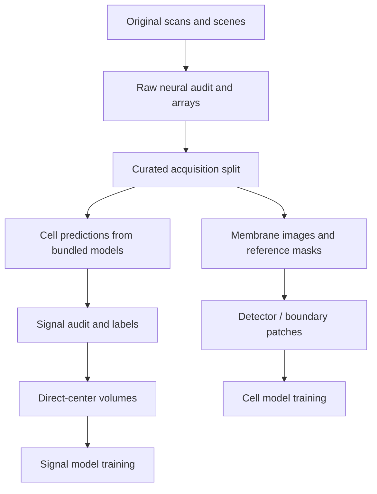

# Training data and rebuilding caches

[Documentation](README.md) · [Models](models.md) · [Neural training](neural-training.md)

The cleanup preserves original microscopy data, painted annotation crops, every
bundled model and every bundled report. Generated training arrays, historical
predictions, logs and packaging outputs have been removed. **Inference needs
models and runtimes, not training caches. Retraining needs regenerated caches.**

## What is retained

| Location | Contents |
|---|---|
| `FISH/` | Original microscopy images and companion annotation scenes |
| `training_annotations/` | Original painted crop arrays and annotation metadata |
| `models/` | Selected checkpoints, thresholds, manifests, licences and origins |
| `reports/` | Release evaluation tables, plots and verification records |
| `training_metadata/` | Local archived audits, acquisition splits, exclusions, recipes, patch indexes and training reports |
| `artifacts/stardist2d-official/` | Original pretrained StarDist input and licence |

`training_metadata/inventory.json` records the original and archived paths and
SHA-256 of every retained metadata file. Files are archived verbatim: paths
inside them describe historical runs and may point to arrays that no longer
exist. An archived report can document training without reopening its deleted
prediction overlays. The archive is local and excluded from Git; copy it along
with the original data when moving the training workspace.

The annotator reads original scans using acquisition/channel metadata, so its
default audit now falls back to the archive. Its training-only exclusions and
held-out leakage checks still apply. Boundary training on the painted crops
also accepts that metadata-only audit.

## Rebuild in dependency order



### 1. Generate a raw audit

For this local workspace, the archived full-collection settings are available:

```bash
.venv/bin/python -m fish_viewer.neural FISH --audit-only \
  --settings training_metadata/full-fish/settings.json \
  --output artifacts/full-fish/audit
```

The command writes images, sparse labels, reference masks and a fresh audit.
It reads the full collection and can take substantial time and disk space.
This is a new audit under the current code. Before reproducing a historical
experiment, compare source identities, acquisition groups, channel choices and
split membership against the archived audit. Do not substitute a newly chosen
split when fine-tuning or evaluating a checkpoint trained on the old one.

### 2. Derive the curated collection

For an evidence-only collection without shape curation:

```bash
.venv/bin/python -m fish_viewer.neural \
  --curate-audit artifacts/full-fish/audit/audit.json --evidence-only \
  --output artifacts/evidence-fish/audit
```

For the historical conservative/balanced recipes, pass their archived settings
with `--settings` and choose separate output folders. The derivation reuses raw
arrays; deleting their parent cache later also breaks the derived collection.

### 3. Build membrane caches and patches

The boundary worker can prepare both before training:

```bash
.venv/bin/python -m fish_viewer.refinement --mode train \
  --audit artifacts/evidence-fish/audit/audit.json \
  --cache artifacts/refinement-fish/audit \
  --patches artifacts/refinement-fish/patches \
  --output artifacts/refinement-fish/training --device cpu
```

This command **also trains a model**; run it only when retraining is intended.
The Viewer offers the same training workflow. For preprocessing-specific arrays,
`scripts/train_preprocessed_stardist.py --prepare-only` creates a separate cache
from a regenerated raw audit. See [boundary refinement](boundary-refinement.md)
and [preprocessed StarDist](preprocessed-stardist.md).

### 4. Regenerate signal inputs

Run the selected cell pipeline over the audited training/validation/test folds,
then build a signal audit using its saved reports. The original candidate CNN
and refreshed dataset have different supervision recipes; consult their archived
configuration instead of mixing them. Build direct-center volumes with:

```bash
.venv-spots/bin/python scripts/build_signal_centers.py \
  --audit artifacts/signal-refresh/data/audit.json \
  --output artifacts/signal-centers/data
```

This requires a **regenerated signal audit and the contour files it references**.
An archived audit alone cannot supply deleted contour arrays. See
[signal detection](signal-detection.md) and [direct signal centers](signal-centers.md).

## Historical patch recipes and fine-tuning

`build_contour_bias_patches.py` accepts `--audit`, `--patch-index` and
`--baseline-reports`; its default indexes and frozen box metadata come from the
local archive. Rebuild membrane images/reference masks first. The script uses
saved box geometry rather than requiring the old binary contour outputs.

`finetune_preprocessed_stardist.py` uses the archived conservative training
report to verify the initial split. For a custom checkpoint, provide
`--initial-training-report`. Existing metadata and checkpoints are not enough
to promise bit-identical retraining: GPU arithmetic, library versions and data
preparation must also be considered.

## Keep environments separate

`.venv/` supplies the GUI and TensorFlow; `.venv-spots/` supplies direct signal
inference/training. Both are needed for the default source-app workflow.
`.venv-freeze/` is retained for packaging. The installed packages were checked
against declared application/neural/test/build dependencies; no obvious orphan
packages were found. CPU-only runtimes could reduce space, but were not substituted.

Use fresh output directories for new experiments. Generated `artifacts/`, run,
`build/` and `dist/` folders are ignored by Git and can be cleaned again after
retaining the necessary checkpoints, metadata and report deliverables.
