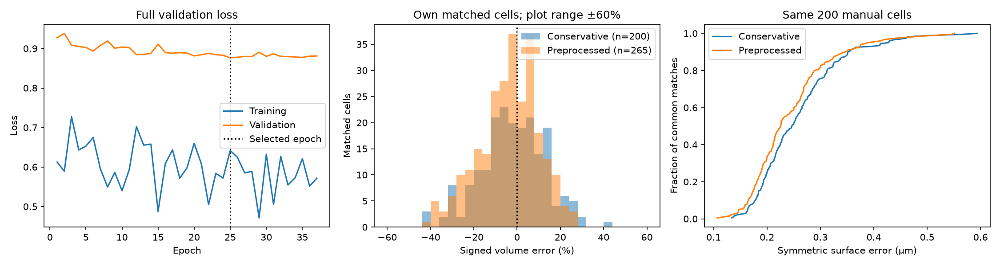
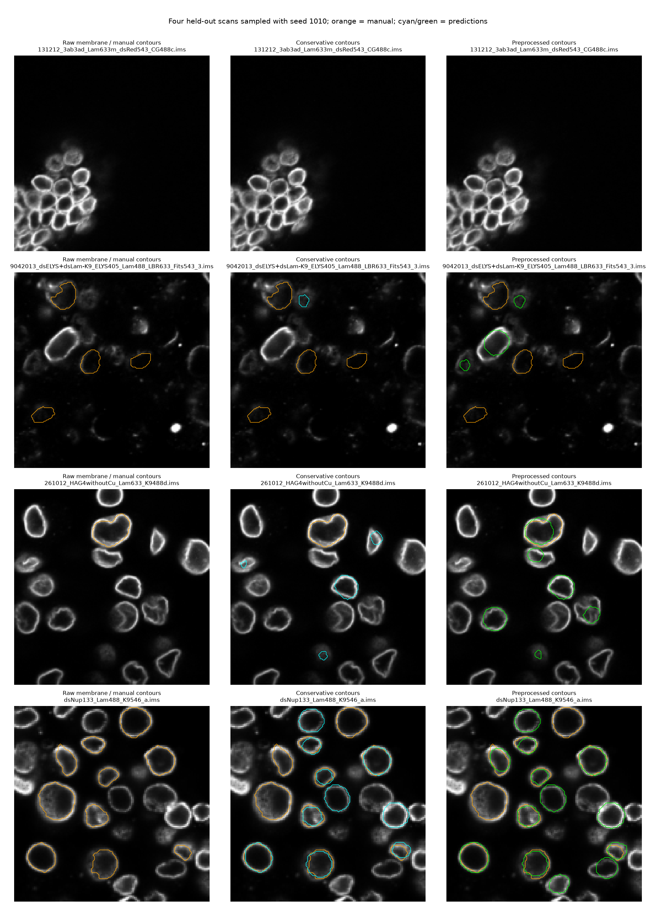

# Membrane-preprocessed StarDist comparison

All 71 original held-out acquisition-group scans, all outliers included, IoU>=0.5 complete manual-cell matches, no signal retention or app roundness filter. Both models use stain-corrected channels; sparse annotations cannot estimate precision. Training channels and preprocessing changed together; this is not an isolated preprocessing ablation.

| Model | Detected cells | Manual matches / 505 | Volume MAPE | Mean surface error |
| --- | ---: | ---: | ---: | ---: |
| Conservative | 1153 | 200 | 11.98% | 0.260 µm |
| Preprocessed StarDist | 2118 | 265 | 11.19% | 0.263 µm |

The common-match comparison contains 200 cells; see comparison.json for paired volume and surface errors.

Training: 1482 complete manual cells from 215 scans, 371 synthetic negatives, 37 epochs; best epoch 25.

The conservative pipeline remains the app default. Select **Preprocessed StarDist (experimental)** to use the additional checkpoint. Its preprocessing is automatic.

Channel corrections affect 108 training, 19 validation, and 36 test scans. Display colors are not network inputs.

Signal-center weights are unchanged. This evaluation measures cell contours, not signal-distance accuracy.

Training-channel correction and enhancement examples: [preprocessing-examples.png](preprocessing-examples.png).
