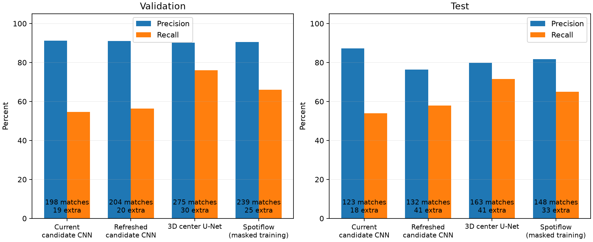
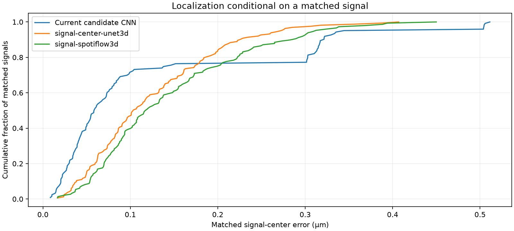

# Direct signal-center comparison — 8 October 2026

The small 3D center U-Net and the upstream 3D Spotiflow network were trained on the full eligible FISH training split. Both propose peaks of learned center heatmaps, with no image candidate finder. Both are usable in the existing apps. **As of v0.4.0, the center U-Net is the default**; the original conservative detector and Spotiflow remain selectable. The new models recover more signals but produce more unmatched detections at their validation-selected cutoffs.

## Frozen test comparison

All models score exactly the same 71 scans, predicted-cell/manual-cell intersections, inferred channels and **228 eligible manual A points**. Matching is one-to-one in the same cell and channel within 0.6 µm. Unknown regions are unscored; unmarked cells are never training negatives.

| Detector | Matched | Unmatched detections | Missed | Precision | Recall | Matched center RMSE |
| --- | ---: | ---: | ---: | ---: | ---: | ---: |
| Current conservative candidate CNN | 123 | 18 | 105 | 87.2% | 53.9% | 0.184 µm |
| Previous refreshed candidate CNN | 132 | 41 | 96 | 76.3% | 57.9% | 0.184 µm |
| **3D center U-Net** | **163** | 41 | **65** | 79.9% | **71.5%** | **0.147 µm** |
| Spotiflow with masked FISH training | 148 | 33 | 80 | 81.8% | 64.9% | 0.170 µm |

Precision means the fraction of detections matched to a manual signal **in scored regions**; recall means the fraction of eligible manual signals recovered. Unmatched detections count as false positives under the complete-label assumption within these regions; they are not necessarily literal blank-image hallucinations. These percentages do not measure accuracy across every cell in an unannotated scan.

The U-Net recovers 40 more references than the default detector, with 23 more unmatched detections. Against the previous refreshed experiment it recovers 31 more references with the same total number of unmatched detections. Spotiflow recovers 25 more references than the default, with 15 more unmatched detections. The default remains the more conservative choice at these fixed operating points. The experiment does not establish that Spotiflow generally performs worse than a U-Net: it tests this configured architecture, supervision and training recipe, without an exhaustive search or pretrained-model comparison.

## Validation and uncertainty

Thresholds and checkpoints were selected on the 73-scan validation fold, maximizing recall subject to 90% precision. All test results above use these frozen choices:

| Model | Selected epoch | Cutoff | Validation precision | Validation recall |
| --- | ---: | ---: | ---: | ---: |
| 3D center U-Net | 23 | 0.736401 | 90.2% | 76.0% |
| Spotiflow | 19 | 0.744656 | 90.5% | 66.0% |

The U-Net completed 38 epochs and stopped after 15 without improved selection. Spotiflow's initial float16 run stopped with a non-finite loss during epoch 17; its finite best epoch 15 checkpoint was recovered with bfloat16 and a restarted AdamW optimizer at 0.0001. Recovery continued through epoch 34 and selected epoch 19. The original failed-stage report is preserved. Spotiflow's flow normalization can produce non-finite values for a zero vector in float16, which is a plausible explanation for the interruption; the bfloat16 numerical regression test passes. Recovery changes the optimization recipe, so this is not an equal-optimizer comparison.

Acquisition-group bootstrap intervals (2,000 resamples; 19 test groups) are:

| Model | Test precision 95% interval | Test recall 95% interval | Paired recall gain over default, percentage points |
| --- | --- | --- | --- |
| U-Net | 59.4–96.1% | 66.3–77.4% | +3.8 to +39.3 |
| Spotiflow | 64.1–93.5% | 51.3–73.5% | +1.5 to +26.2 |

The broad precision intervals indicate substantial acquisition variability. The validation precision target does not guarantee 90% test precision. The test fold has been reused in previous experiments: this is an exploratory comparison, not an untouched prospective accuracy estimate. No test threshold tuning was used for these new models.

Matched localization errors are conditional on recovery of a signal, and the models match different subsets. U-Net mean center error is 0.125 µm, versus 0.124 µm for the default; its lower RMSE therefore does not imply a large improvement in average center error. These are **signal-center errors**, not signal-to-border distance errors or cell-volume errors. Cell boundary disagreement remains relevant to distance measurements.

## Models, graphs and use

Select [models/signals-center-unet](../../models/signals-center-unet) or [models/signals-spotiflow](../../models/signals-spotiflow) in the signal model field after installing the optional `setup-spots` runtime. The existing detector remains in [models/signals](../../models/signals). See [setup and reproduction](../../docs/signal-centers.md). Both new models produce the existing centers, channel scores, counts, cell filtering, B points, distances, Excel and Imaris exports.

- [U-Net training report](unet-training/report.json), [training graph](unet-training/training-progress.png), [validation](unet-validation/report.json), [test](unet-test/report.json), [example heatmaps](unet-examples/validation-examples.png).
- [Spotiflow recovery training report](spotiflow-training/report.json), [training graph](spotiflow-training/training-progress.png), [original interrupted stage](spotiflow-original-stage/report.json), [validation](spotiflow-validation/report.json), [test](spotiflow-test/report.json), [example heatmaps](spotiflow-examples/validation-examples.png).
- [CSV comparison](comparison.csv), [data summary](data-summary.json), [runtime versions](runtime.json).

The example crops are selected by fixed corpus order: the first eligible record from each of six distinct validation acquisition groups. They are maximum projections, which hide axial position, and are not a replacement for the full numerical comparison. Blue crosses are manual A centers; green rings are scored accepted centers; cyan is the projection of the predicted cell mask.

The corpus contains 215 training scans, 1,760 training cell/channel crops and all 676 eligible training A points. Each eligible A receives a centered training sample every epoch, plus a random known-region sample for every cell/channel. The 73 validation and 71 test scans contain 362 and 228 eligible points respectively. Unknown regions, ambiguous marker regions and unsafe excluded-A neighborhoods have zero training loss; scoring uses the original benchmark ROI separately so these training exclusions do not conceal false detections. The four previously excluded heterogeneous scans remain excluded.

Verification: 152 application tests passed (6 optional-runtime tests skipped), and 13 direct-center tests passed in the isolated PyTorch runtime. The focused app was exercised with both architectures on CPU, including counts, volumes, nearest-border geometry, A/B lines, Excel, Imaris scene export, 2D/3D display and unchanged source pixels. Both final checkpoints accept zero signals on synthetic blank, constant, low-noise and membrane-only controls. The numerical controls do not establish field precision. Native Windows and the proprietary Imaris application were not executed in this environment.

## Volume and border-distance measurements

The subsequent [measurement comparison](measurements/README.md) calculates actual
signal-to-border errors against manual A–B lines. Mean absolute distance error
is 0.129 µm for both models; the same-signal comparison does not establish a
meaningful difference. Both use identical cell contours and share the 9.63%
mean absolute volume percentage error on 314 matched complete cells before
signal filtering.
