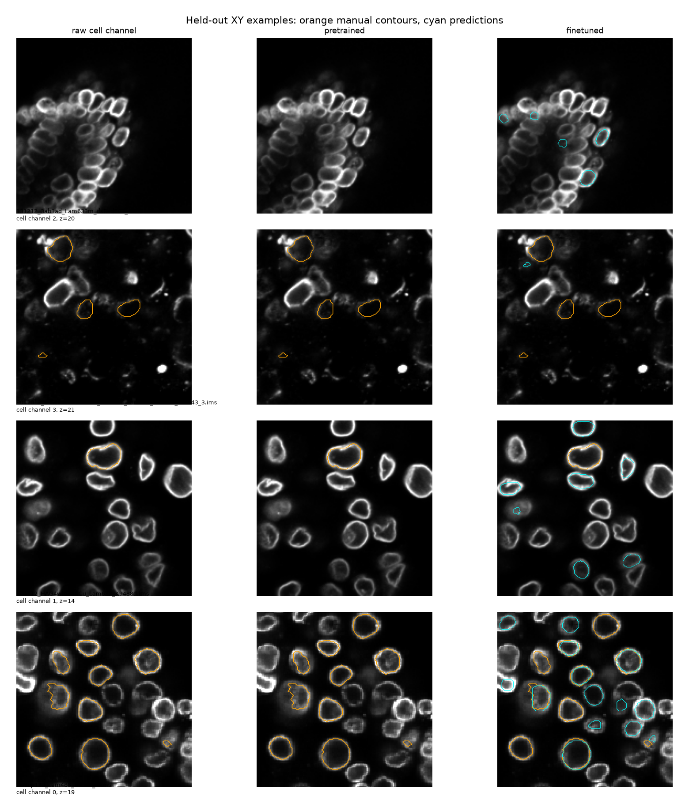

# Official StarDist2D fluorescence fine-tuning

Official model: [2D_versatile_fluo](https://github.com/stardist/stardist-models/releases/tag/v0.1). Archive checksum verified against the installed official StarDist registry.

Fine-tuned 40 epochs; best validation epoch 40. Training scans: 215; validation: 73; held-out test: 71.

Acquisition-safe XY sections of complete 3D manual cells; other real pixels unknown=-1; synthetic blank/noise=0. No held-out optimization.

Input is the corrected single cell intensity channel, enhanced with membrane-connected-v1 and enlarged 2x in XY. Up to seven sections per annotated complete cell; all 1,482 eligible training cells included. Neither signal channels nor RGB display colors are network inputs.

Network architecture and initial weights are the official 32-ray, depth-3 2D U-Net. All weights fine-tuned at 3e-5. Unknown real pixels have disabled probability loss; distance background regularization is zero. Synthetic blanks/noise provide limited negative supervision.

Adjacent XY polygons are joined by one-to-one Hungarian IoU matching (minimum 0.2). Missing slices break tracks; no gap filling or contour dilation. The 2D models use the preprocessed 3D model’s raw membrane-evidence and physical size acceptance settings; the conservative 3D baseline keeps its original settings. No roundness or signal-retention filtering. The 2D experiment uses the unchanged official probability threshold and NMS 0.3, with no held-out threshold tuning.

| Method | All contours | Manual matches / 505 | Volume MAPE | Surface error µm |
|---|---:|---:|---:|---:|
| pretrained | 4 | 0 | — | — |
| finetuned | 1399 | 197 | 7.72% | 0.245 |
| conservative | 1153 | 200 | 11.98% | 0.260 |
| preprocessed | 2118 | 265 | 11.19% | 0.263 |

Volume and surface errors are conditional on whole-cell IoU≥0.5. Different methods can match different cells; comparison.json includes pairwise intersections and the intersection across all four methods. Sparse annotations cannot establish full-field precision. All outliers included.

This is a 2D experiment with a separate 3D linking algorithm, not a pretrained 3D model. It can fragment cells where 2D sections disappear. StarDist polygons still require star-convex shapes per section. The model is trained originally for fluorescent nuclei, while FISH contains membrane-stained cells, so domain shift remains.

The signal-center U-Net is unchanged. Fine-tuned 2D is now the Analysis default; the 3D presets remain available. The default-setting signal-to-border benchmark is in [distance measurements](distances/README.md).

Checkpoint: models/cells-stardist2d/best.weights.h5. Select **Fine-tuned StarDist 2D (default)** in the analysis app to use it with the existing signal and measurement pipeline.

On the 163 manual cells matched by both fine-tuned 2D and preprocessed 3D, volume MAPE is **7.39% versus 11.16%**, and mean symmetric surface error is **0.244 versus 0.259 µm**. This supports a contour-accuracy improvement on the shared matched population. Fine-tuned 2D matches only **197/505 (39.0%)**, versus **265/505 (52.5%)** for preprocessed 3D. Its mean per-cell HD95 is worse (**0.871 versus 0.692 µm**), so lower average error does not mean uniformly better boundaries. These limitations remain despite its selection as the new app default. Signal-to-border accuracy is reported separately in the default-setting distance benchmark.

Fine-tuned 2D signed mean volume error is **+2.03%** (85 of 197 volumes are smaller than manual), so the average volume shrinkage is not present in this matched population. This does not rule out local inward boundary errors.

Verification: 219 non-integration tests passed, including batched 2D inference equivalence and zero unknown-pixel loss gradients. All six synthetic no-cell controls accepted zero contours. A standalone CPU application to an unannotated Imaris scan with explicit cell channel 1 produced 18 calibrated contour objects.
