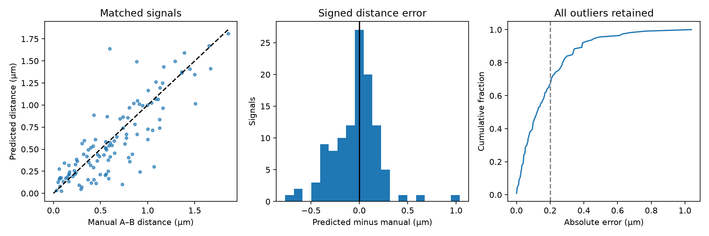

# Fine-tuned StarDist 2D default: signal distances

All **71 held-out test scans** were processed with frozen 2D contours, **minimum roundness 0.72**, the unchanged signal-center U-Net, any-signal cell retention and the production distance-measurement code. No threshold tuning on test. Distances are shortest Euclidean distances from predicted signal centers to the calibrated 3D cell mesh, in micrometers.

| Measurement | Result |
|---|---:|
| Signals matched to manual A–B measurements | 112 |
| Distance MAE | 0.175 µm |
| Distance RMSE | 0.247 µm |
| Median absolute distance error | 0.124 µm |
| Signed mean distance error | -0.040 µm |
| 95th percentile absolute error | 0.474 µm |
| Mean absolute percentage error | 40.16% |
| Median absolute percentage error | 26.07% |
| Acquisition-bootstrap 95% CI for MAE | 0.136–0.211 µm |
| Errors within 0.2 µm | 67.0% |
| Median manual distance | 0.581 µm |
| Matched retained complete cells with volume measurements | 121 |
| Mean absolute volume error after default filters | 5.64% |
| Final retained cells, including unscored cells | 478 |
| Predicted signals, including unscored detections | 524 |

Only complete manual cells matched at whole-cell IoU ≥0.5 qualify. Signal matches are one-to-one, within the same cell/channel and ≤0.6 µm. Ground truth distances are actual stored manual A–B segments, not synthetic distances. Manual signal membership must be unique and the channel unambiguous. All outliers are included. Multiple signal channels are processed independently; CSV channels are zero-based. A channel number can denote different stains in different scans.

Volume error is conditional on 121 matched cells surviving roundness and signal retention; it is not the unfiltered 197-cell contour comparison. Distance accuracy likewise does not measure missed cells or signals. Small manual distances magnify percentage errors. This reused, previously inspected test fold gives exploratory accuracy estimates, not independent prospective validation. These pairs differ from older model evaluations, so changes in their headline averages alone do not establish improvement.

The default GUI was checked through signal detection, point B creation, distance lines, Imaris/Excel export and 2D/3D display. Native Imaris application opening is not part of that verification.

